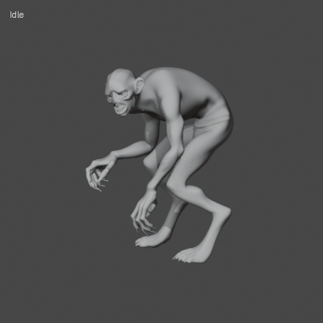

# Creature source

Open `Creature_Animations.blend` in Blender 5.2. Select Creature_Rig, then choose an action in the Action Editor.

Game assets: `RecoveredProjects/TheGhost_School_Unity6/Assets/CreatureAnimations`.

The generation scripts retain their original local workspace paths; update P/OUT before rebuilding.

